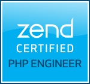

Hi there :wave:

My name is Dorian Neto. I'm Brazilian, and I was born and raised in [Fortaleza, CE](https://maps.app.goo.gl/kSdE1zKPaUHdZLns7). I'm currently living in [Newfoundland & Labrador, Canada](https://maps.app.goo.gl/rA4LC7EtT7SeDxWr9) and working remotely as a Software Engineer at [SourceKnowledge](https://sourceknowledge.com/).

I've been working since 2011 as a developer. Throughout my career, I have had the opportunity to work for companies from Brazil, Mexico and Canada. Among the several ideas that I'm fascinated by in software development, **tackling business problems by designing and architecting solutions** is what makes my eyes light up :star:.

- [Talks](/talks "Talks")
- [Mentorship](/mentorship "Mentorship")

## Some of my achievements

I have:

- led developer teams
- built several end-to-end web solutions
- improved countless internal processes
- advocated for developer experience
- participated in hiring developers (junior, mid-level and senior)
- worked with different programming languages
- experienced direct communication with stakeholders
- been working remotely for 10+ years
- worked with people from different cultures, countries, and languages
- built MVPs from scratch
- managed projects
- guided several trainees
- attended several events from non-profit communities as an organizer and speaker
- got a PHP certification from Zend (ZEND030288)


    

