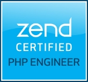

Hi there :wave:

My name is Dorian Neto. I'm Brazilian, and I was born and raised in [Fortaleza, CE](https://maps.app.goo.gl/kSdE1zKPaUHdZLns7). I'm currently living in [Newfoundland & Labrador, Canada](https://maps.app.goo.gl/rA4LC7EtT7SeDxWr9) and working remotely as a Software Engineer at [SourceKnowledge](https://sourceknowledge.com/).

I've been working since 2011 as a developer. Throughout my career, I have had the opportunity to work for companies from Brazil, Mexico and Canada. Among the several ideas that I'm fascinated by in software development, **tackling business problems by designing and architecting solutions** is what makes my eyes light up :star:.

- [Talks](/talks "Talks")
- [Mentorship](/mentorship "Mentorship")
- ZCE (ZEND030288)


    

