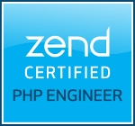

Olá :wave:

Me chamo Dorian Neto. Sou Brasileiro, nasci e fui criado em [Fortaleza, CE](https://maps.app.goo.gl/kSdE1zKPaUHdZLns7). Atualmente, moro em [Newfoundland & Labrador, Canada](https://maps.app.goo.gl/rA4LC7EtT7SeDxWr9) e trabalho remotamente como Software Engineer na [SourceKnowledge](https://sourceknowledge.com/).

Trabalho como desenvolvedor desde 2011. Ao longo da minha carreira, tive a oportunidade de trabalhar para empresas do Brasil, México e Canadá. Dentre os diversos pontos que me fascinam na área de desenvolvimento de software, **resolver problemas de negócios por meio da concepção e arquitetura de soluções** é o que faz meus olhos brilharem :star:.

- [Palestras](/talks "Palestras")
- [Mentoria](/mentorship "Mentoria")

## Algumas das minhas conquistas

Eu:

- liderei equipes de desenvolvimento
- desenvolvi diversas soluções web de ponta a ponta
- aprimorei inúmeros processos internos
- promovi melhorias na experiência do desenvolvedor
- participei de processos de contratação de desenvolvedores (níveis júnior, pleno e sênior)
- trabalhei com diferentes linguagens de programação
- tive experiência em comunicação direta com as partes interessadas (stakeholders)
- trabalho remotamente há mais de 10 anos
- trabalhei com pessoas de diferentes culturas, países e idiomas
- criei MVPs do zero
- gerenciei projetos
- orientei diversos estagiários
- participei de vários eventos de comunidades sem fins lucrativos, atuando como organizador e palestrante
- obtive uma certificação PHP da Zend (ZEND030288) [:eyes:](/pt/posts/guia-de-sobrevivencia-de-um-zcpe-zce/)


    

