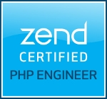

Olá :wave:

Me chamo Dorian Neto. Sou Brasileiro, nasci e fui criado em [Fortaleza, CE](https://maps.app.goo.gl/kSdE1zKPaUHdZLns7). Atualmente, moro em [Newfoundland & Labrador, Canada](https://maps.app.goo.gl/rA4LC7EtT7SeDxWr9) e trabalho remotamente como Software Engineer na [SourceKnowledge](https://sourceknowledge.com/).

Trabalho como desenvolvedor desde 2011. Ao longo da minha carreira, tive a oportunidade de trabalhar para empresas do Brasil, México e Canadá. Dentre os diversos pontos que me fascinam na área de desenvolvimento de software, **resolver problemas de negócios por meio da concepção e arquitetura de soluções** é o que faz meus olhos brilharem :star:.

- [Palestrante](/talks "Palestrante")
- [Mentor](/mentorship "Mentor")
- ZCE (ZEND030288) [:eyes:](/pt/posts/guia-de-sobrevivencia-de-um-zcpe-zce/)


    

